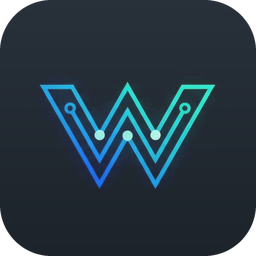

# WireDraft

Portable electrical drawing software for IEC drawing sets, with offline AI from local models and an MCP server.
No installer, no npm dependencies, no internet.
(Now its in testing stage, use it on your own risk, play with it, enjoy)

https://karthhic.github.io/Wiredraft/index.html



## Run it

**Portable build** (any Windows 10/11 x64 PC):

```
node build/build-exe.mjs        → dist/WireDraft/   (copy this folder anywhere, e.g. a USB stick)
dist/WireDraft/WireDraft.exe    → opens the editor in its own window; closing the window stops it
```

**From source** (Node 22+): `start.bat`, or `node app/server.js` (add `--no-window` to just serve http://127.0.0.1:5178).

## What it does

- **Multi-page projects**: a title page, numbered pages (2, 3, 3.1…) and generated report pages, on A4, A3 or A2 landscape (set per project, overridable per page).
- **Frame and title block**: a 0–9 column strip. Two templates (full-width or a compact corner block) are filled from **per-project** data: company, address, logo, customer, drawing number, revision, =function / +location.
- **IEC symbols** (IEC 60617 shapes, IEC 81346 tags):
  - protection: MCB 1–4P, RCD, motor protection switch, fuse, main switch
  - switching: coils, main and auxiliary contacts, push-buttons, E-stop, overload, lamps
  - power: motors, PSU, socket, transformer
  - terminals, plugs and cable markers; PLC I/O
  - black boxes with your own pins; connection points and interruption points
- **Devices, not just drawings**: a contactor's coil and contacts share one tag (`-K1`), so cross-references are computed automatically. Each contact shows `/3.4` back to its coil, the coil lists its contacts, and interruption points show `L1 → 2.9`.
- **Wires** route orthogonally. Click a pin to start a wire, click empty space to add bends, and click another wire to join it with a T-junction. Each wire carries a wire number, potential, size, colour, cable and core.
- **Reports**: a **terminal diagram** per strip (cable, core, outside and inside targets, bridge, size and colour, page.column) and a **cable list** with optional lengths and totals per cable type. They regenerate from the drawing.
- **Checks**: unconnected pins, duplicate terminals, contacts without a coil, unpaired interruption points, cables missing from the list, cable lengths not set, ratings missing.
- **Export**:
  - **PDF**: multi-page vector PDF via the built-in Edge/Chrome engine
  - **DXF**: R12 format, layered, one file per page
  - **DWG**: through an optional file converter, if installed
  - SVG, and a project file for sharing
- **Your own symbols**: **Symbols → + New** opens the symbol editor. You can draw lines, rectangles, circles, arcs, polylines and text, and place pins. Then set the name (per language), category, tag letter, cross-reference role (coil or contact) and the properties to show. Right-click any symbol in the palette to edit it if it is yours, or to copy it as a new symbol if it is built in. Symbols are saved as JSON in `library/symbols/`, so you can share them by copying files. Each project stores copies of the custom symbols it uses, so it opens on any PC. MCP clients can create symbols too (`save_symbol`).
- **Symbols from images**: **Symbols → Image →** (or **Import image…** inside the symbol editor) converts a picture of a symbol (PNG, JPG, a scan or a photo) into editable vector lines:
  - *Centre lines* mode traces line drawings as single vector lines; *Outlines* mode traces filled shapes.
  - Sliders adjust the width in mm, the dark/light threshold and the amount of simplification, with a live preview over the original image.
  - Near-straight lines are straightened and rings become true circles.
  - After converting, the pin tool opens so you can click where wires connect. Pins snap to the nearest line end, and the lead is pulled onto the 2 mm grid.
  - **Trace over image** (or **Background image…** in the editor, or *Keep as background* in the import panel) puts the picture behind the drawing at a size, visibility and position you choose, so you can draw the symbol by hand on top. The picture is only a guide: saving keeps your lines, text and pins and leaves the image out.
  - Editing in the symbol editor: drag on empty space for **box selection**, **Shift+click** adds or removes items, **Ctrl+A** selects all. Move or nudge (arrow keys) the whole selection; **Copy / Cut / Paste / Duplicate** (Ctrl+C / X / V / D or the tool-column buttons). The clipboard also works between symbols, and pasted pins get a new name if theirs is already taken.
  - The **Size** panel resizes any symbol by width, height or %, with or without keeping proportions, and **Centre** moves it onto the insertion point.
- **Languages**: `lang/*.json`, one file per language, switchable live, with English as the fallback. English and Finnish are included. Drawings follow the interface language unless the project fixes a drawing language. To add a language, drop a new file into `lang/`; a template is available at `/api/lang/template`.

## Local AI

WireDraft talks to **Ollama**:

1. A portable runtime in `resources/runtime/ollama/` is started on 127.0.0.1:11500, with its models in `resources/models/`.
2. Otherwise WireDraft uses an installed Ollama (`config.json` → `ollama`).

The model never draws. It returns JSON operations that the same engine applies, checks and lets you undo. For standard circuits it uses **macros** (`dol_starter`, `start_stop`, `terminal_strip`), which are always wired correctly.

| Model | Size | Use |
| --- | --- | --- |
| `qwen2.5-coder:7b` | 4.7 GB | Chat → edits, review (default) |
| `qwen2.5-coder:14b` | 9 GB | Better at hand-wired circuits, ~3× slower |
| `qwen2.5vl:3b` / `:7b` | 3.2 / 6 GB | Image or sketch → page (experimental) |

To fill `resources/models`, copy `manifests/` and `blobs/` from `%USERPROFILE%\.ollama\models` (only the models you need).

## MCP server

`WireDraft.exe --mcp` (or `node app/server.js --mcp`) speaks MCP over stdio and works on the same project files. An open editor window updates live.

```json
{ "mcpServers": { "wiredraft": { "command": "E:\\WireDraft\\WireDraft.exe", "args": ["--mcp"] } } }
```

Tools:
- reading: `list_projects`, `create_project`, `get_project`, `get_page`, `list_symbols`
- symbols: `save_symbol`, `list_custom_symbols`
- editing: `apply_ops`, the main tool, which also accepts macros
- checking: `check_project`, `get_reports`, `generate_reports`
- output: `export` (pdf/dxf/dwg/svg) and `render_page` (a PNG, so vision clients can see the page)

For Claude Code inside this repo, `.mcp.json` is already set up.

## Folder layout

```
WireDraft\
  WireDraft.exe        app launcher (Node single-executable, ~90 MB)
  app\                 editor, server, MCP, shared core (plain JS)
  lang\                en.json, fi.json, ... one file per language
  library\symbols\     your own symbols (one JSON file each)
  projects\            your projects: <name>.wdp\ project.json, devices.json, cables.json, pages\*.json
  exports\             PDF / DXF / DWG output
  samples\             Demo-Panel, copied into projects\ on first run
  resources\runtime\ollama\  resources\models\  resources\tools\ (optional DWG converter)
  config.json          port, interface language, default paper, models
```

## Development

```
npm test                       core tests (ops, macros, cross-references, reports, DXF, i18n)
node build/make-sample.mjs     rebuild samples/Demo-Panel.wdp
node build/build-exe.mjs       portable build in dist/WireDraft
```

Keyboard shortcuts:

| Key | Action |
| --- | --- |
| V / W / T / L / B | Select, wire, text, line, box |
| R | Rotate |
| Del | Delete |
| Esc | Cancel |
| Ctrl+C / V / D | Copy, paste, duplicate |
| Ctrl+Z / Y | Undo, redo |
| F | Fit page |
| PgUp / PgDn | Previous / next page |
| Arrows | Nudge 4 mm |
| Wheel | Zoom |
| Middle-drag | Pan |
